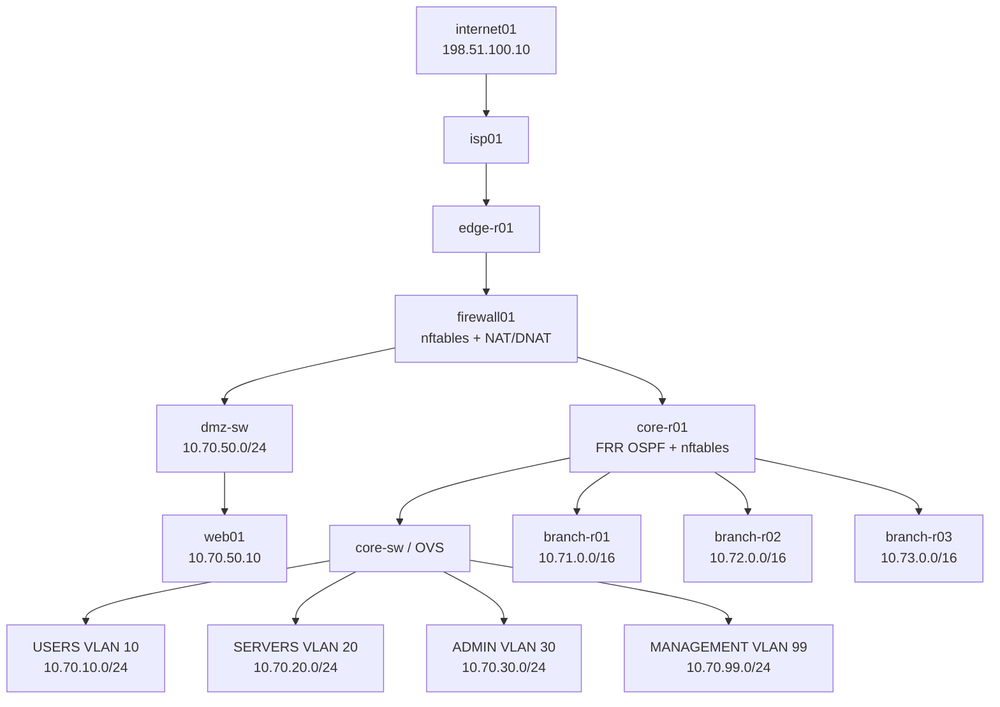

# Enterprise Security Mirror
## ARCHITECTURE.md | Versión 0.2 | 26 de octubre de 2026

**Estado:** propuesta de arquitectura v0.2; no desplegada.  
**Repositorio proyectado:** `enterprise-security-mirror`.  
**Referencia vigente:** [`network-security-labs`, Lab 12](https://github.com/seezelop/network-security-labs/tree/main/labs/12-enterprise-network-security).  
**Documento complementario:** [`PROJECT_PLAN.md`](PROJECT_PLAN.md).

> **Principio rector:** una sola empresa simulada, tres bloques transversales y tres escenarios espejo. Cada escenario debe probar qué ocurrió, qué control previno o detectó la actividad, qué quedó invisible y cómo se verificó una mejora. La infraestructura de redes ya implementada en Lab 12 es el punto de partida, no algo a rehacer.

## 1. Decisiones y estado

| Decisión | Estado |
|---|---|
| Conservar el Lab 12 original | Acordado; no modificarlo |
| Crear un repositorio independiente y reutilizar una copia versionada de Lab 12 | Acordado; repositorio todavía no creado |
| Mantener HQ + tres sucursales, OSPF, VLAN, DMZ y nftables | Confirmado en fuente y acordado |
| Organizar el nuevo proyecto en bloques A, B y C | Acordado |
| Desarrollar ESC-001, ESC-002 y ESC-003 | Acordado |
| ESC-001 = DMZ Web; ESC-002 = Identity; ESC-003 = Lateral Movement | Numeración definitiva acordada |
| Incorporar Active Directory mediante Windows Server/KVM | Objetivo condicionado a prueba de recursos y conectividad |
| Incorporar GitHub Actions desde el inicio, con aprendizaje guiado | Acordado; primero CI estática/offline y luego regresiones |
| Implementar IPS inline, IPsec, 802.1X/NAC y redundancia | Objetivos posteriores; no existen hoy en el Lab 12 |

**Importante:** las IP, productos y controles identificados como *propuestos* no describen el estado actual.

## 2. Empresa simulada y procesos

Empresa ficticia de servicios con una sede central y tres sucursales. Áreas: **Operaciones, Administración, Recursos Humanos e IT**. Clientes, usuarios, claves y documentos serán sintéticos.

Procesos de negocio propuestos:

1. Empleados consultan su aplicación corporativa desde HQ o sucursales según políticas de acceso.
2. El portal web de la DMZ recibe solicitudes externas de clientes simulados.
3. Administradores IT acceden a los sistemas de gestión por canales autorizados.
4. El sistema de identidad valida cuentas, grupos, permisos y eventualmente acceso a la red.
5. Los controles defensivos registran actividad y diferencian tráfico legítimo de indicios de abuso.

**Activos que proteger:** cuentas, datos de prueba, acceso a servicios de negocio, continuidad de enlaces, integridad de reglas y disponibilidad de la DMZ.

## 3. Topología de referencia: qué existe

La topología vigente del Lab 12 contiene **18 contenedores** y switches externos **Open vSwitch**. Los dispositivos, rutas y políticas están definidos en `lab12.clab.yml`, `configs/` y `validation/`.

**Detalles comprobados en el repositorio:**

- `web01` (`10.70.50.10`) está publicado desde `203.0.113.2:443` mediante DNAT; hoy responde un listener Netcat, **no HTTP/TLS real**.
- `app01` (`10.70.20.20`), `dns01` (`10.70.20.10`) y `mgmt01` (`10.70.99.10`) también contienen listeners sintéticos.
- `core-r01` permite USERS de HQ, BR1 y BR2 hacia `app01` TCP/443, pero excluye BR3; ADMIN dispone de una regla amplia hacia SERVERS.
- La política de `firewall01` permite Internet a DMZ TCP/443 y deniega por defecto el resto del tráfico reenviado; **DMZ → SERVERS no está habilitado**.
- Existen doce tests de política de red; varios esperan banners Netcat. **Al sustituir servicios, esos tests deberán migrarse a protocolos y respuestas reales.**

Esta es la base de red. **No se debe llamar “infraestructura empresarial con servicios reales” a los listeners actuales.**

## 4. Arquitectura objetivo: qué agregaremos

Conservar plano de red y sumar servicios auténticos e identidades, por etapas:

| Zona / nodo | Función actual | Incorporación propuesta | Fase |
|---|---|---|---|
| DMZ `web01` | Netcat TCP/443 | HTTPS real (reverse proxy o servidor TLS) + portal con autenticación y logs | ESC-001 primero |
| SERVERS `app01` | Netcat TCP/443 y 22 | API de negocio con roles/operaciones y auditoría; despliegue separado del piloto DMZ | Después del piloto |
| SERVERS `dns01` | Netcat TCP/53 | Resolver DNS real o servicio de nombres adaptado a AD | ESC-002 |
| USERS `user01` | Alpine | Cliente sintético que ejecute flujos de negocio normales y pruebas controladas | ESC-001 |
| ADMIN `admin01` | Alpine | Administración con credenciales ficticias y registros de acciones | ESC-002 / ESC-003 |
| MANAGEMENT `mgmt01` | Netcat TCP/22 | Colector de logs liviano y herramientas de investigación; no asumir SIEM completo | ESC-001 |
| SERVERS, **nuevo** | No existe | VM Windows Server Core con AD DS, DNS y grupos; IP candidata `10.70.20.30` | Condicionado |
| USERS, **nuevo** | No existe | VM cliente Windows con Sysmon; IP candidata `10.70.10.20` | Condicionado |
| HQ/BR1 | OSPF sin túnel | VPN IPsec con strongSwan | ESC-003 |
| WAN sucursal | Una ruta física lógica por sucursal | Segundo camino y prueba de convergencia | ESC-003 |
| Acceso de sucursal | Hosts Linux | FreeRADIUS + EAP/EAP-TLS; autenticador 802.1X real a verificar | ESC-002 |

**Decisión de implementación para ESC-001:** en su primera iteración, `web01` tendrá un servicio **autocontenido en DMZ** (aplicación y almacenamiento de datos sintéticos), evitando abrir apresuradamente un flujo DMZ → SERVERS. La futura separación front/back se diseñará con una política de mínimos privilegios y tests explícitos.

**No se reemplazan hoy** todos los nodos ni se instalan todas las herramientas. Los servicios se introducen cuando cumplen una necesidad investigable.

### 4.1 Flujos de negocio y autorizaciones iniciales

| Flujo | Política prevista | Evidencia |
|---|---|---|
| `internet01` → `web01` TCP/443 vía `203.0.113.2` | Permitir | HTTP/TLS exitoso + logs |
| `web01` → SERVERS | Denegar inicialmente | Contador/registros nftables |
| `user01` → `app01` TCP/443 | Permitir según zona y luego por identidad | Respuesta de API + autenticación |
| BR3 USERS → `app01` TCP/443 | Denegar según Lab 12 | Test negativo |
| HQ ADMIN → MANAGEMENT (servicios aprobados) | Permitir mínima superficie | Registro de administración |
| Usuarios no autorizados → operaciones restringidas | Denegar a nivel de aplicación | Evento de autorización |
| Contenedor → red de gestión Docker / host | Revisar aislamiento; no considerar protegido por las ACL del plano de datos | Prueba de no-bypass |

El aislamiento por VLAN y las reglas de capa 3 **no sustituyen** autenticación y autorización por operación.

## 5. Cinco capas de seguridad y puntos de observación

| Capa | Controles | Fuente de evidencia | Límite relevante |
|---|---|---|---|
| Perímetro y DMZ | nftables, DNAT, reverse proxy/TLS | Logs `firewall01`, HTTP, aplicación | Firewall L3/L4 no decide autorizaciones de negocio |
| Tránsito y sedes | OSPF, segmentación, IPsec, redundancia | Rutas, flujos, métricas failover | IPsec cifra contenido en tránsito; inspeccionar antes/después del túnel según objetivo |
| Acceso e identidad | cuentas/roles; más adelante AD, EAP, RADIUS/NAC | Logs de identidad/autenticación | Autenticación de red ≠ autorización de recursos |
| Sistemas y aplicaciones | políticas de roles, host logging, hardening | Logs de API, auditoría Linux/Windows | Acciones intravlan pueden no cruzar `core-r01` |
| Detección y respuesta | reglas Python, Suricata IDS, correlación, regresiones | Alertas, EVE JSON, PCAP sintéticos | Ausencia de alerta ≠ ausencia de actividad maliciosa |

**Sensor ESC-001:** comenzar con **logs de la aplicación y del firewall**; incorporar Suricata en modo pasivo con una ubicación de captura deliberada y verificable (p. ej., espejo OVS/puerto de inspección). No asumir que un sensor en `core-r01` observa todo el tráfico de la DMZ ni que verá el contenido de TLS sin instrumentación de aplicación.

**IPS inline:** pendiente de definir un punto de interceptación compatible con la política y de medir rendimiento/reversibilidad. No confundir IDS pasivo con IPS preventivo.

## 6. ESC-001: primer escenario espejo (diseño del piloto)

**Pregunta de negocio:** ¿una aplicación publicada en la DMZ permite un acceso u operación indebida y qué podemos reconstruir a partir de los controles existentes?

**Aplicación candidata:** portal de clientes ficticios desarrollado en Python, accesible mediante HTTPS y con operaciones sencillas (login, lectura de expedientes sintéticos y acción restringida). Implementación aún por seleccionar. Cualquier condición vulnerable debe ser **intencional, documentada, aislada y reversible**.

**Capa 1, empresa y detección:**
- Convertir `web01` en aplicación HTTPS real manteniendo `10.70.50.10`.
- Crear identidades y objetos ficticios, roles y operaciones autorizadas.
- Generar actividad normal y definir **qué eventos no deben generar alertas**.
- Registrar `timestamp`, `actor`, `source`, `request_id`, `action`, `resource`, `decision`, `result`.
- Recolectar registros de aplicación y eventos nftables; agregar IDS pasivo si los recursos lo permiten.
- Validar tráfico permitido y denegado, alcance del sensor y línea base.

**Capa 2, prueba adversaria y defensa:**
- Introducir **un** defecto reproducible, preferentemente autorización incorrecta sobre un recurso sintético, con datos de prueba.
- Ejecutar desde una identidad de bajo privilegio dentro del entorno aislado.
- Registrar secuencia, resultado, controles que bloquearon o alertaron y actividad que quedó sin detectar.
- Aplicar hardening o corregir la autorización; comparar estado anterior y posterior.

**Capa 3, límites de detección:**
- Repetir una variante controlada que cambie los atributos visibles del evento, sin escapar del entorno ni atacar sistemas ajenos.
- Diferenciar claramente: fallo de prevención, fallo de recolección, fallo de detección y falso positivo.
- Mejorar regla/telemetría y ejecutar pruebas de regresión sobre ambos casos.

**Indicadores de salida del piloto** (umbrales por definir al observar la línea base real):
1. La aplicación responde HTTPS real por el camino DNAT.
2. Una operación válida y una no autorizada quedan registradas con un ID correlacionable.
3. Se demuestra al menos una detección con trazabilidad `acción → evento → regla → alerta`.
4. Se documenta al menos un punto ciego real, con explicación causal.
5. Se compara una defensa antes/después y hay una prueba reproducible que lo verifica.
6. Los tests de routing, OSPF, segmentación y DNAT siguen pasando con aserciones adaptadas.
7. Las evidencias que van a GitHub no contienen contraseñas, tokens ni datos personales.

**Separación importante:** un test de regresión exitoso que confirme que el evento evadió una regla demuestra un **punto ciego reproducible**, no una detección exitosa.

## 7. Los otros dos escenarios y sus dependencias

| Escenario | Problema empresarial | Componente decisivo | Evidencia diferencial |
|---|---|---|---|
| ESC-001: DMZ Web Application Compromise | Portal publicado y operación indebida | aplicación real + logs + reglas de detección | ruta de ataque, alertas, puntos ciegos y corrección |
| ESC-002: Identity & Privilege Abuse | Privilegios excesivos y acceso de dispositivos/usuarios | AD cuando sea viable; RADIUS/EAP-TLS/802.1X cuando haya autenticador compatible | decisiones de identidad, permisos, registros y pruebas negativas |
| ESC-003: Lateral Movement, Segmentation & Resilience | Acceso entre zonas, dependencia de HQ y enlace caído | ACL/routing existentes; luego IPsec y enlace secundario | recorrido, controles de red y tiempo de recuperación medido |

**Extensión explícita:** SPF/DKIM/DMARC como subsistema posterior de correo empresarial ficticio. No introducirlo artificialmente en ESC-001.

## 8. Presupuesto de recursos y modo de operación

**Mediciones del equipo (informadas por el usuario):** Ubuntu físico, 7,0 GiB RAM utilizable, Intel Core i7-7500U (2 núcleos/4 hilos), disco con gran margen libre, `/dev/kvm` accesible y módulos `kvm` cargados.

- Lab 12 desplegado: 18 contenedores activos; consumo agregado informado por `docker stats` en una medición anterior de aproximadamente 115 MiB, que **no equivale al uso total de Docker, OVS y el host**.
- Medición sin Firefox/VS Code: aproximadamente 5 GiB `available`.
- Medición posterior con 18 contenedores activos: aproximadamente 4 GiB `available`.
- **QEMU, virsh y virt-install no estaban instalados** en la última revisión.

### Presupuesto tentativo, NO medido todavía

| Grupo | Reserva de planificación inicial | Estado |
|---|---:|---|
| Ubuntu + escritorio + componentes de red | Medir en reposo durante ESC-001 | No fijar consumo por sumar RSS |
| Aplicación HTTPS + servidor de prueba | 0,2 a 0,6 GiB | Hipótesis de dimensionamiento, medir |
| Recolección básica y reglas Python | 0,1 a 0,3 GiB | Hipótesis, medir |
| Suricata pasivo | 0,3 a 1,0 GiB o más | Muy dependiente de reglas y tráfico; medir |
| VM Windows Server Core | 2,5 a 3 GiB asignados para una prueba inicial | No validado; no comprometer despliegue |
| VM cliente Windows / Wazuh completo | No reservado | Fuera de simultaneidad inicial |

**Regla operativa:** arrancar un solo componente nuevo, verificar el funcionamiento y medir `free -h`, memoria/cpu de Docker y latencia de servicio antes de añadir otro. No planificar ejecución simultánea de Windows Server, cliente Windows y Wazuh completo en este equipo.

## 9. Integración futura de KVM con Open vSwitch

Camino conceptual: VM KVM/libvirt → NIC virtual tipo bridge → `servers-sw` o `users-sw` → puerto OVS de acceso etiquetado → VLAN correspondiente → `core-r01`.

- Uso de `virtualport type='openvswitch'` y bridge OVS externo, según documentación de OVS.
- Validar **antes** el etiquetado VLAN y la ruta de paquetes de la VM.
- Evitar redes NAT de libvirt que esquiven las rutas y ACL empresariales.
- Ajustar las reglas nftables para AD solo cuando se implemente, contemplando DNS TCP/UDP, Kerberos, LDAP, SMB y RPC realmente requeridos.
- Revisar `deploy-lab.sh` y `cleanup-ovs.sh`: el segundo elimina bridges y ciertos interfaces. El nuevo ciclo de vida deberá desconectar/gestionar las VMs con seguridad antes de limpiar OVS.

**Referencia técnica:** https://docs.openvswitch.org/en/latest/howto/libvirt/

## 10. GitHub Actions y pruebas

**Objetivo formativo:** el usuario todavía no utilizó GitHub Actions. Aprenderá con un primer workflow corto (push/PR → runner → job → steps → checks), que evolucionará conforme existan tests útiles. Ver `PROJECT_PLAN.md` para hitos CI-01 a CI-04.

Dos niveles independientes:

**CI alojada en GitHub (desde el inicio):** sintaxis/formatos de YAML y JSON; tests de Python y reglas de detección con fixtures sintéticos; escaneo de secretos; validación de estructura de evidencias. Permisos mínimos `contents: read`; dependencias fijadas por versión.

**Pruebas integrales locales (después):** desplegar Containerlab y OVS; probar OSPF, reglas y NAT, aplicaciones, identidades, sensores, casos legítimos y adversarios, y producir reportes. Evitar introducir pruebas de ataque en runners públicos hospedados o en un runner permanente de la notebook personal.

**Cambio que debemos realizar:** reemplazar paulatinamente los tests basados en banners Netcat por tests HTTP/TLS, DNS y SSH reales **sin perder los controles negativos de política**.

Referencia GitHub Actions: https://docs.github.com/en/actions/reference/workflows-and-actions/workflow-syntax

## 11. Riesgos y controles de implementación

| Riesgo | Medida de diseño |
|---|---|
| Publicar un servicio vulnerable fuera del laboratorio | Internet y direcciones simuladas, rutas aisladas, no mapear puertos al host ni a Internet |
| Ruta alternativa por red Docker de gestión | Revisar ruta e interfaces efectivas de cada contenedor; tests de no-bypass |
| Sensor mal ubicado | Capturas de prueba y matriz de visibilidad por flujo |
| Suposición de inspección del contenido TLS | Inspección en endpoint/aplicación y metadatos de red; documentar límites |
| Reglas de AD abren acceso demasiado amplio | Lista mínima de puertos/fuentes/destinos y tests positivos/negativos |
| Script de limpieza rompe puertos de VM | Ciclo de vida explícito y guardas antes de eliminar OVS |
| Servicios nuevos invalidan 12 tests previos | Migración controlada de pruebas con regresión equivalente |
| Comprometer el rendimiento con demasiados servicios | Módulos activos por escenario, mediciones antes/después |
| Filtrar secretos o datos personales al portfolio | Dataset sintético, revisión manual, secret scanning y evidencias sanitizadas |

## 12. Puertas de avance y acciones siguientes

**H0, diseño documentado (esta versión):**
- [x] Empresa, zonas, servicios candidatos y escenarios definidos.
- [x] Asignación de bloques A/B/C y primer piloto.
- [ ] Registrar SHA de commit exacto de Lab 12 como punto de partida.
- [ ] Crear repositorio independiente e incorporar `PROJECT_PLAN.md`, `ARCHITECTURE.md` y `BOOTSTRAP.md`.

**H1, base reproducida (siguiente actividad técnica):**
- [ ] Crear copia derivada independiente del Lab 12, sin alterar el original.
- [ ] Validar 18 nodos y 12 pruebas originales **antes** de sustituir listeners.
- [ ] Auditar aislamiento del management plane y las rutas.
- [ ] Añadir estructura mínima CI GitHub Actions (sin ataques reales).

**H2, primer servicio empresarial:**
- [ ] Diseñar datos sintéticos, roles, operaciones y esquema de logs del portal.
- [ ] Reemplazar Netcat de `web01` por HTTPS real, solo en el repo nuevo.
- [ ] Actualizar prueba TCP/443/DNAT a prueba de servicio real.
- [ ] Medir RAM/CPU/latencia.

**H3, ESC-001 completo:**
- [ ] Línea base, telemetría, escenario adversario controlado.
- [ ] Detección, explicación de punto ciego, mejora y regresión.
- [ ] Evidencia sanitizada y reporte de investigación en GitHub.

**H4/H5:** incorporar identidad real para ESC-002 y resiliencia/IPsec para ESC-003 conforme a las mediciones.

## 13. Derivación del Lab 12

La copia inicial se obtiene del **árbol Git de un commit concreto** de `network-security-labs/labs/12-enterprise-network-security`, no de la carpeta runtime que Docker/Containerlab pudiera haber generado en el equipo. Consultar `BOOTSTRAP.md` para comandos y precauciones.

1. Crear `enterprise-security-mirror` como repositorio Git nuevo e independiente.
2. Importar solo el subárbol de Lab 12 a `infrastructure/containerlab/`, preservar su estructura interna y guardar SHA de procedencia.
3. No lanzar la copia mientras permanezca desplegado el Lab 12 original: el nombre actual `lab12`, los `clab-lab12-*`, las interfaces y los bridges OVS externos colisionan.
4. Validar con una sola topología activa; después planear renombrar topología, referencias de test, bridges y scripts para aislar los ciclos de vida.
5. Añadir CI-01 sin depender de Docker privilegiado ni de KVM en el runner de GitHub.

## 14. Registro de decisiones

| ID | Decisión | Justificación | Estado |
|---|---|---|---|
| ADR-001 | Un repo, una empresa, tres escenarios | Coherencia y trazabilidad de portfolio | Aprobada |
| ADR-002 | Lab 12 original inmutable | Conservar evidencia y reproducibilidad | Aprobada |
| ADR-003 | Pilotear primero ESC-001 | Menor coste de recursos, ruta DMZ existente | Aprobada |
| ADR-004 | Portal DMZ inicialmente autocontenido | No abrir DMZ → SERVERS de forma prematura | Propuesta |
| ADR-005 | IDS pasivo antes de IPS inline | Verificar observabilidad y coste | Propuesta |
| ADR-006 | CI estática/offline y pruebas integrales locales | Evitar requisitos de privilegios/seguridad en runners públicos | Aprobada |
| ADR-007 | AD con KVM si supera validación | Realismo de identidades compatible con hardware | Condicionada |
| ADR-008 | Importar árbol del Lab 12 mediante snapshot de Git a nuevo repo | Evitar copiar `.git` y estado runtime; preservar SHA de origen | Aprobada |
| ADR-009 | Renumerar: DMZ=ESC-001; Identity=ESC-002 | Orden creciente de ejecución | Aprobada |

## Fuentes técnicas

- [Lab 12 original](https://github.com/seezelop/network-security-labs/tree/main/labs/12-enterprise-network-security)
- [Lab 12 topología](https://github.com/seezelop/network-security-labs/blob/main/labs/12-enterprise-network-security/lab12.clab.yml)
- [Lab 12 firewall interno](https://github.com/seezelop/network-security-labs/blob/main/labs/12-enterprise-network-security/configs/core-r01/internal-policy.nft)
- [Lab 12 firewall perimetral](https://github.com/seezelop/network-security-labs/blob/main/labs/12-enterprise-network-security/configs/firewall01/nftables.conf)
- [OVS con libvirt](https://docs.openvswitch.org/en/latest/howto/libvirt/)
- [Suricata EVE JSON](https://docs.suricata.io/en/latest/output/eve/eve-json-output.html)
- [GitHub Actions workflow syntax](https://docs.github.com/en/actions/reference/workflows-and-actions/workflow-syntax)
