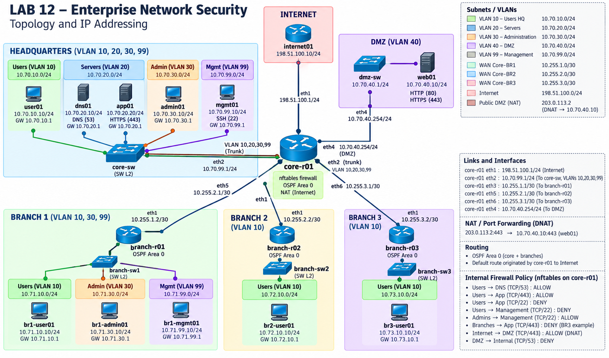
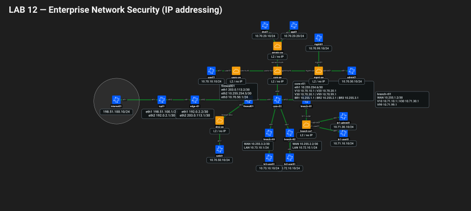
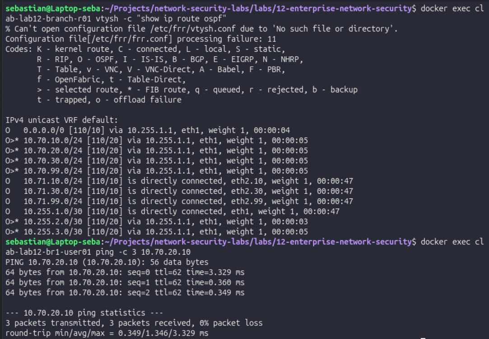
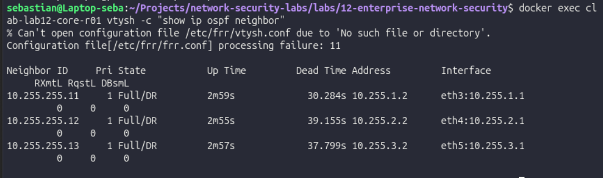
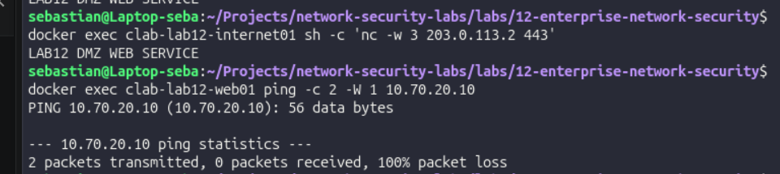
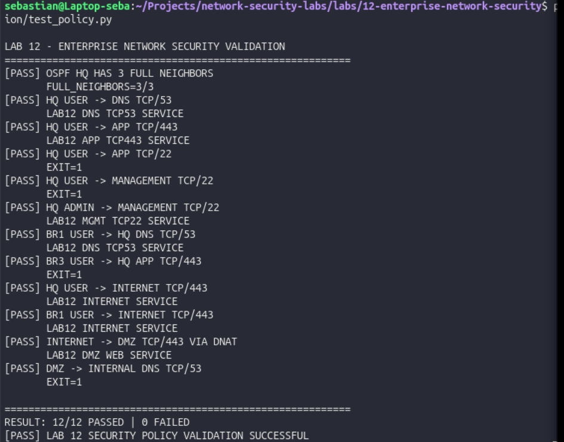

# LAB 12 – Enterprise Network Security Architecture & Validation

## Overview

LAB 12 is the final integrated networking and network-security project in this repository.

The lab models a small enterprise with a headquarters, three branch offices, centralized Internet access, a DMZ, segmented internal networks, dynamic routing, stateful firewalls, NAT, and automated security-policy validation.

The objective is not only to provide connectivity, but to demonstrate that **network reachability and authorization are different concepts**.

The lab was built with Linux, Docker, Containerlab, Open vSwitch, FRRouting, nftables, and Python.

---

## Architecture

### Logical architecture



### Containerlab topology



The environment contains:

- Headquarters with separate USERS, SERVERS, ADMIN, and MANAGEMENT networks.
- Three branch offices connected to HQ through routed WAN links.
- OSPF Area 0 for enterprise routing.
- Centralized Internet breakout through HQ.
- A dedicated perimeter firewall.
- A separate DMZ containing a published service.
- Stateful east-west filtering inside the corporate network.
- Automated PASS/FAIL validation of the intended security policy.

---

## Addressing Plan

### Headquarters

| Zone | Network | Main systems |
|---|---|---|
| USERS | `10.70.10.0/24` | `user01` – `10.70.10.10` |
| SERVERS | `10.70.20.0/24` | `dns01` – `10.70.20.10`, `app01` – `10.70.20.20` |
| ADMIN | `10.70.30.0/24` | `admin01` – `10.70.30.10` |
| MANAGEMENT | `10.70.99.0/24` | `mgmt01` – `10.70.99.10` |
| DMZ | `10.70.50.0/24` | `web01` – `10.70.50.10` |

`core-r01` provides the internal gateways:

- VLAN 10: `10.70.10.1`
- VLAN 20: `10.70.20.1`
- VLAN 30: `10.70.30.1`
- VLAN 99: `10.70.99.1`

The DMZ gateway is provided directly by the perimeter firewall:

- DMZ gateway: `10.70.50.1`

### Branch 1

| Zone | Network | Host |
|---|---|---|
| USERS | `10.71.10.0/24` | `br1-user01` – `10.71.10.10` |
| ADMIN | `10.71.30.0/24` | `br1-admin01` – `10.71.30.10` |
| MANAGEMENT | `10.71.99.0/24` | gateway `10.71.99.1` |

WAN:

- HQ: `10.255.1.1/30`
- BR1: `10.255.1.2/30`

### Branch 2

- USERS: `10.72.10.0/24`
- `br2-user01`: `10.72.10.10`
- WAN HQ: `10.255.2.1/30`
- WAN BR2: `10.255.2.2/30`

### Branch 3

- USERS: `10.73.10.0/24`
- `br3-user01`: `10.73.10.10`
- WAN HQ: `10.255.3.1/30`
- WAN BR3: `10.255.3.2/30`

### Perimeter

| Link / Zone | Addressing |
|---|---|
| Simulated Internet | `198.51.100.0/24` |
| ISP ↔ Edge | `192.0.2.0/30` |
| Edge ↔ Firewall | `203.0.113.0/30` |
| Firewall ↔ Core | `10.255.254.4/30` |

The public/documentation address exposed by the firewall is:

`203.0.113.2`

The TEST-NET address ranges used in this lab are intentional and are reserved for documentation and laboratory use.

---

## Enterprise Routing

FRRouting is used on the enterprise routers.

All corporate routers participate in **OSPF Area 0**:

- `core-r01`
- `branch-r01`
- `branch-r02`
- `branch-r03`

LAN-facing interfaces are passive. OSPF adjacencies are formed only across the WAN links.

The HQ router originates the default route so branch traffic can use centralized Internet breakout.

Validation confirmed three OSPF neighbors in the `Full` state and successful route learning between HQ and all branches.





---

## Security Architecture

The lab implements multiple complementary controls instead of relying on a single firewall.

### Segmentation

Separate network zones are used for:

- USERS
- SERVERS
- ADMIN
- MANAGEMENT
- DMZ
- Branch networks

This reduces the attack surface and provides clear policy boundaries.

### Stateful Perimeter Firewall

`firewall01` uses nftables with a **default-deny forwarding policy**.

Stateful inspection allows return traffic only for already permitted connections:

`ct state established,related`

The perimeter firewall is responsible for:

- North-south filtering.
- Source NAT for corporate Internet access.
- Destination NAT for the DMZ service.
- DMZ isolation.
- Drop counters and logging.

### NAT

Corporate systems reach the simulated Internet through centralized SNAT.

Traffic from the corporate networks is translated to the firewall's outside address:

`203.0.113.2`

### DMZ Publication

The externally reachable TCP/443 service is published with DNAT:

`203.0.113.2:443 → 10.70.50.10:443`

The DMZ is not trusted simply because it belongs to the enterprise environment.

Traffic initiated from the DMZ toward internal networks is denied by default.



---

## East-West Security Policy

`core-r01` uses nftables in addition to FRRouting.

This allows the same node to perform dynamic routing and enforce internal east-west policy.

The policy applies **least privilege** between corporate segments.

| Source | Destination | Service | Expected |
|---|---|---:|---|
| HQ USERS | DNS server | TCP/53 | ALLOW |
| HQ USERS | APP server | TCP/443 | ALLOW |
| HQ USERS | APP server | TCP/22 | DENY |
| HQ USERS | MANAGEMENT | TCP/22 | DENY |
| HQ ADMIN | MANAGEMENT | TCP/22 | ALLOW |
| BR1 USERS | HQ DNS | TCP/53 | ALLOW |
| BR3 USERS | HQ APP | TCP/443 | DENY |
| HQ USERS | Internet | TCP/443 | ALLOW |
| BR1 USERS | Internet | TCP/443 | ALLOW |
| Internet | DMZ | TCP/443 | ALLOW through DNAT |
| DMZ | Internal DNS | TCP/53 | DENY |

The different treatment of BR1 and BR3 demonstrates that security policy can vary by location rather than granting identical access to every branch.

---

## Automated Security Validation

The intended network policy is defined in:

`validation/policy.yaml`

The validation engine is:

`validation/test_policy.py`

It tests:

- OSPF neighbor state.
- Allowed TCP flows.
- Denied TCP flows.
- Branch-to-HQ access.
- Centralized Internet access.
- DNAT to the DMZ.
- DMZ isolation.

Run:

```bash
python3 validation/test_policy.py
```

Expected result:

```text
RESULT: 12/12 PASSED | 0 FAILED
[PASS] LAB 12 SECURITY POLICY VALIDATION SUCCESSFUL
```

A denied connection is considered a **PASS** when the policy explicitly expects that connection to be blocked.



---

## Repository Structure

```text
12-enterprise-network-security/
├── configs/
│   ├── branch-r01/
│   ├── branch-r02/
│   ├── branch-r03/
│   ├── core-r01/
│   └── firewall01/
├── containers/
│   └── frr-nft/
├── docs/
├── evidence/
├── scripts/
│   ├── cleanup-ovs.sh
│   ├── configure-switching.sh
│   ├── deploy-lab.sh
│   └── setup-ovs.sh
├── validation/
│   ├── nft-ruleset.txt
│   ├── policy.yaml
│   └── test_policy.py
├── lab12.clab.yml
└── README.md
```

Containerlab-generated directories such as `clab-lab12/` are runtime state and are not part of the source configuration.

---

## Requirements

The lab was developed on Linux and requires:

- Docker
- Containerlab
- Open vSwitch
- Python 3
- Git
- Internet access when building the custom image for the first time

FRRouting containers are based on:

`quay.io/frrouting/frr:10.6.1`

A small custom image adds nftables to FRR for the internal core router.

---

## Reproducing the Lab

### 1. Build the custom FRR + nftables image

From the LAB 12 directory:

```bash
docker build \
  -t lab12-frr-nft:10.6.1 \
  -f containers/frr-nft/Dockerfile .
```

The image extends FRRouting with nftables so `core-r01` can provide both OSPF routing and east-west filtering.

### 2. Clean an existing deployment

```bash
sudo containerlab destroy -t lab12.clab.yml || true
./scripts/cleanup-ovs.sh
sudo rm -rf clab-lab12
```

### 3. Create the external Open vSwitch bridges

```bash
./scripts/setup-ovs.sh
```

### 4. Deploy the Containerlab topology

```bash
sudo containerlab deploy -t lab12.clab.yml
```

### 5. Apply VLAN and trunk configuration

```bash
./scripts/configure-switching.sh
```

### 6. Validate the security policy

```bash
python3 validation/test_policy.py
```

The expected final result is:

```text
RESULT: 12/12 PASSED | 0 FAILED
```

---

## Automated Deployment

The complete deployment and validation workflow can also be executed with:

```bash
./scripts/deploy-lab.sh
```

The script:

1. Builds the custom FRR+nftables image.
2. Removes any previous Containerlab deployment.
3. Cleans residual Open vSwitch state.
4. Recreates the required OVS bridges.
5. Deploys the topology.
6. Applies VLAN configuration.
7. Executes the automated security-policy validation.


---

## Post-Deployment Verification

After deployment, the topology status can be verified with:

```bash
sudo containerlab inspect -t lab12.clab.yml

docker exec clab-lab12-core-r01 \
  vtysh -c "show ip ospf neighbor"

python3 validation/test_policy.py

```

---

## Stopping and Cleaning the Lab

To stop the lab and remove its generated runtime state:

```bash
sudo containerlab destroy -t lab12.clab.yml
./scripts/cleanup-ovs.sh
sudo rm -rf clab-lab12

```
---

## Why OVS Cleanup Is Required

The Open vSwitch bridges used by this lab are **externally managed resources**.

Containerlab can attach links to them, but it does not fully own their lifecycle.

During development, stale OVS ports and Linux veth interfaces caused deployment errors such as existing interfaces and configuration drift.

For this reason:

`cleanup-ovs.sh`

explicitly removes LAB 12 bridges and residual interfaces before a clean deployment.

This makes rebuilding the environment deterministic.

---

## Management Plane vs Data Plane

Containerlab also provides each container with a Docker management interface (`eth0`).

During testing, this management network introduced its own default route through `172.20.20.1`.

On branch routers, that route initially competed with the OSPF-learned enterprise default route.

The branch configurations therefore remove the management-plane default route so production traffic follows the intended data-plane path:

`Branch → OSPF → HQ → firewall01 → Internet`

This distinction between the management plane and the routed data plane was an important troubleshooting point in the lab.

---

## Security+ Concepts Applied

This project applies several concepts covered by CompTIA Security+ in an integrated environment:

- Network segmentation
- Security zones
- DMZ architecture
- Least privilege
- Default deny
- Defense in depth
- Stateful inspection
- NAT and port forwarding
- Secure management segmentation
- East-west vs north-south traffic
- Attack-surface reduction
- Logging and counters
- Zero Trust principles
- Automated control validation

A system being located on an internal network is **not treated as sufficient evidence of trust**.

---

## Important Lab Limitations

This is a controlled training environment.

The services listening on TCP/22, TCP/53, and TCP/443 are lightweight Netcat listeners used to validate Layer 3/Layer 4 policy.

Therefore:

- TCP/443 does not represent a real TLS/HTTPS implementation.
- TCP/53 does not represent a real DNS server.
- TCP/22 does not represent a real SSH daemon.

The purpose of these listeners is to provide deterministic endpoints for testing routing, firewall rules, NAT, and segmentation.

The networking and security controls themselves are implemented using real Linux networking, FRRouting, Open vSwitch, and nftables.

---

## Evidence

The repository includes evidence collected during validation:

- `01-ospf-routing-validation.png`
- `02-ospf-neighbors-full.png`
- `03-dmz-policy-validation.png`
- `04-automated-security-policy-validation.png`

Together these demonstrate:

- Dynamic route exchange.
- Three OSPF adjacencies in `Full`.
- Controlled Internet-to-DMZ publication.
- DMZ-to-internal isolation.
- Automated validation of the final security policy.

---

## Result

The final environment successfully combines:

**Layer 2 segmentation → Layer 3 routing → OSPF → centralized Internet breakout → stateful firewalling → NAT/DNAT → DMZ → internal least-privilege policy → automated validation**

The final policy validation completed with:

`12/12 PASSED | 0 FAILED`

This LAB closes the networking series by moving from isolated protocol exercises to an integrated, reproducible enterprise network-security architecture.